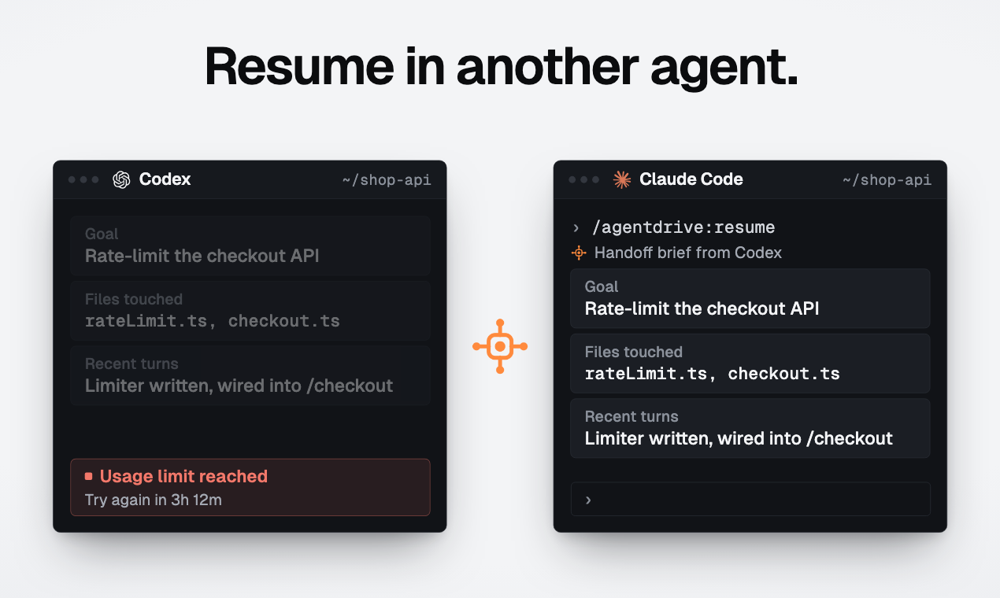

# AgentDrive

**Hit your usage limit in one coding agent. Keep going in another, with the same context.**

[](./LICENSING.md)
[](https://www.npmjs.com/package/@adrive/cli)
[](https://www.npmjs.com/package/@adrive/mcp-server)

[](https://go2.gg/agentdrive-film)

[Watch the 30-second film](https://go2.gg/agentdrive-film) · [Website](https://go2.gg/agentdrive) · [Quick start](https://go2.gg/agentdrive-docs)

AgentDrive syncs your sessions across Claude Code, Codex, OpenCode, Cursor and Antigravity. When you switch agents, the next one gets a handoff brief with the goal, the files touched and the recent turns, so you do not have to explain the task again.

## Quick start

Install the CLI and connect every agent it finds (Node.js 22.15 or later):

```bash
curl -fsSL agentdrive.sh/install | sh
```

The script installs `@adrive/cli` and runs `adrive init`, which signs you in through the browser and wires session sync hooks, the MCP server and the resume commands into Codex, OpenCode, Cursor and Antigravity. If the `claude` command is on your PATH, it also installs the Claude Code plugin. Read it first with `curl -fsSL agentdrive.sh/install | less`; the source is [`apps/installer/install.sh`](./apps/installer/install.sh).

To set up Claude Code on its own, install the plugin from inside it, then run `/agentdrive:login`:

```
/plugin marketplace add agentdrive-sh/agentdrive-mcp
/plugin install agentdrive@agentdrive
```

Work in one agent. When you switch, open the next agent in the same project directory and run `/agentdrive:resume` in Claude Code, or `adrive resume` in a terminal. You can also ask the agent to resume your last AgentDrive session.

Video walkthroughs: [Install AgentDrive and connect your coding agents](https://youtu.be/sm9-RbE8oUw) and [Resume a Codex session in Claude Code](https://youtu.be/nj7esMsJiwA). More on the [YouTube channel](https://go2.gg/agentdrive-youtube).

## Three ways to run it

| Mode | What you get | Setup |
|---|---|---|
| Local, no account | Resume between agents on one machine | `npm install -g @adrive/cli` |
| Hosted ([plans](https://go2.gg/agentdrive)) | Sync across machines, shared workspace, search and sharing | `curl -fsSL agentdrive.sh/install \| sh` |
| Self-hosted | The same server on your own Cloudflare account, API-key only | `pnpm selfhost` |

### Local mode

Without a login, the CLI reads each agent's own transcripts on disk. Nothing is uploaded. In your project directory:

```bash
adrive resume --list     # recent sessions for this project, across agents
adrive resume            # handoff brief for the latest one
adrive resume --local    # force local mode even when you are logged in
```

Claude Code, Codex and OpenCode sessions need no setup. Cursor and Antigravity record no project directory in their transcripts, so their sessions show up once `adrive init --local` has wired the agents' hooks.

The MCP server's `drive_sessions` and `drive_resume` tools also work without an API key, so an agent can list and resume local sessions on its own:

```json
{
  "mcpServers": {
    "agentdrive": {
      "command": "npx",
      "args": ["-y", "@adrive/mcp-server"]
    }
  }
}
```

### Self-hosted on Cloudflare

The server is a Cloudflare Worker backed by KV, R2, Vectorize and Workers AI:

```bash
git clone https://github.com/agentdrive-sh/agentdrive.git
cd agentdrive
pnpm install
pnpm selfhost
```

Self-hosting is community-supported and needs the Workers Paid plan. A self-hosted instance is API-key only: the script registers your owner key and prints the `adrive auth login --with-key` command that connects the CLI to your deployment. See the [self-hosting guide](https://agentdrive.sh/docs/self-hosting).

## Supported agents

| Agent | Session sync and resume | MCP tools |
|---|---|---|
| Claude Code | Yes (plugin or installer) | Yes |
| Codex | Yes | Yes |
| OpenCode | Yes | Yes |
| Cursor | Yes | Yes |
| Antigravity | Yes | Yes |
| Cline | Not yet | Yes |
| Zed | Not yet | Yes |
| Continue | Not yet | Yes |

Sync adapters for Cline, Zed and Continue are good first contributions; see [`CONTRIBUTING.md`](./CONTRIBUTING.md#where-to-start).

## What you get

- **Cross-agent resume.** `adrive resume`, `/agentdrive:resume` in Claude Code, or the `drive_sessions` and `drive_resume` MCP tools.
- **22 MCP tools** for files, versions, comments, shares, activity, semantic search, run logs and session resume ([reference](https://agentdrive.sh/docs/mcp-tools)).
- **Provenance.** One API key is a principal; each agent identifies its platform and role per request, so every write keeps the name of the agent that made it.
- **Private Workspace.** Content the CLI syncs can be encrypted client-side (AES-256-GCM) before upload.
- **Bring your own bucket.** Point a workspace at your own R2 or any S3-compatible bucket.
- **REST API and TypeScript SDK** (`@adrive/sdk`) for agents that do not speak MCP.

## Architecture

```
                    +-------------------+
  Claude Code  -->  |                   |
  Codex        -->  |  MCP / REST / CLI |  -->  Cloudflare Worker (Hono)
  Cursor       -->  |                   |               |
  LangGraph    -->  +-------------------+               v
                                              +-------------------+
                                              | R2 content store  | content-addressed (sha256)
                                              | KV metadata       | workspaces, sessions, tokens
                                              | Vectorize index   | 768-dim embeddings
                                              | Workers AI        | BGE-base-en-v1.5
                                              | BucketDriver      | R2 default / R2 cross-account / S3-HMAC
                                              +-------------------+
```

The full system overview is in [`docs/tech/architecture.md`](./docs/tech/architecture.md), and the load-bearing decisions are recorded as ADRs under [`docs/tech/adr/`](./docs/tech/adr/).

## Repository layout

```
apps/
  worker/      REST API and hosted MCP (Hono on Cloudflare Workers)
  web/         Next.js marketing site, docs and dashboard
  frontend/    Legacy React dashboard
  docs/        Legacy Astro docs
  installer/   One-line install script
packages/
  cli/         adrive CLI (@adrive/cli)
  mcp-server/  Stdio MCP server (@adrive/mcp-server)
  sdk-ts/      TypeScript SDK (@adrive/sdk)
  shared/      Types, ids, HMAC token sign/verify, Zod schemas
plugins/
  agentdrive/  Claude Code plugin
```

## Documentation

- [agentdrive.sh/docs](https://agentdrive.sh/docs): [quick start](https://go2.gg/agentdrive-docs), [sessions](https://agentdrive.sh/docs/concepts/sessions), [MCP tools](https://agentdrive.sh/docs/mcp-tools), [REST API](https://agentdrive.sh/docs/rest-api). Source in [`apps/web/content/docs/`](./apps/web/content/docs/).
- [`CONTRIBUTING.md`](./CONTRIBUTING.md): dev setup, house style and where to start.
- [`docs/tech/`](./docs/tech/): architecture and ADRs.
- [`docs/ops/runbook.md`](./docs/ops/runbook.md): deploy, rollback and secret rotation.

## License

The server (`apps/worker`, `apps/web`, `apps/frontend`) is licensed under the [GNU AGPL v3](./LICENSE). You can self-host and modify it freely; if you run a modified version as a network service, you must offer its source to your users.

The clients (`packages/cli`, `packages/mcp-server`, `packages/sdk-ts`, `packages/shared`, `apps/installer`, the Claude Code plugin) are Apache-2.0. Talking to the server over the network does not make your code AGPL.

A commercial license is available for organizations that cannot use AGPL: `licensing@agentdrive.sh`. Contributions require a signed [CLA](./CLA.md). The AgentDrive name and logo are covered by [`TRADEMARKS.md`](./TRADEMARKS.md). Full details in [`LICENSING.md`](./LICENSING.md).

Copyright 2026 Roushan Inc.
