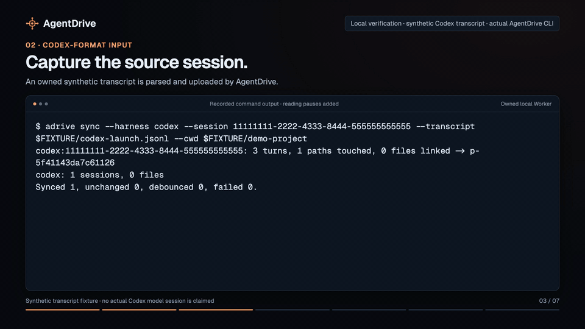

# AgentDrive

**Start in any agent. Finish in any other.**



<sub>Replay of real CLI output from a synthetic transcript.</sub>

AgentDrive captures your coding-agent sessions and turns them into a handoff brief any other agent can pick up: the goal, the files touched and the recent turns. Work in Codex, then resume the same task in Claude Code, Cursor or Gemini CLI without re-explaining it. Artifacts your agents write land in a shared workspace with provenance for every agent, semantic search and storage you can point at your own bucket.

In the demo, `adrive sync` captures a Codex-format session and `adrive resume` returns its goal and files touched to a different agent platform.

---

## Quick start

There are three ways to run AgentDrive.

### 1. Local mode, no account

Resume works on one machine without signing up: AgentDrive reads each agent's own transcripts on disk. Install the CLI (Node.js 22.15 or later):

```bash
npm install -g @adrive/cli
```

Without a login, `adrive resume` reads your agents' transcripts straight from disk. In your project directory:

```bash
adrive resume --list     # recent sessions for this project, across agents
adrive resume            # handoff brief for the latest one
adrive resume --local    # force local mode even when you are logged in
```

The MCP server's `drive_sessions` and `drive_resume` tools also work without an API key, so an agent can list and resume local sessions on its own:

```json
{
  "mcpServers": {
    "agentdrive": {
      "command": "npx",
      "args": ["-y", "@adrive/mcp-server"]
    }
  }
}
```

Claude Code, Codex and OpenCode sessions need no setup. Cursor and Antigravity record no project directory in their transcripts, so their sessions are found once `adrive init --local` has wired the agents' hooks; the same goes for Gemini CLI sessions opened outside the project root.

Local mode reads transcripts from disk only. Cross-machine resume, the shared workspace, search and sharing need the hosted service or a self-hosted server.

### 2. Hosted service

One line installs the CLI, signs you in, and wires every agent it finds:

```bash
curl -fsSL agentdrive.sh/install | sh
```

It installs `@adrive/cli`, runs `adrive init` to log in through the browser, and wires session capture hooks, the MCP server and the resume commands into Codex, OpenCode, Gemini CLI, Cursor and Antigravity. Zed, Cline and Continue get the MCP server only. Read the script first with `curl -fsSL agentdrive.sh/install | less`; its source is [`apps/installer/install.sh`](./apps/installer/install.sh).

In Claude Code, install the plugin instead:

```
/plugin marketplace add agentdrive-sh/agentdrive-mcp
/plugin install agentdrive@agentdrive
```

Then run `/agentdrive:login`. The hosted API lives at [app.agentdrive.sh](https://app.agentdrive.sh); plans and limits are on [agentdrive.sh](https://agentdrive.sh).

### 3. Self-host on Cloudflare

The server is a Cloudflare Worker backed by KV, R2, Vectorize and Workers AI. To run it on your own Cloudflare account:

```bash
git clone https://github.com/agentdrive-sh/agentdrive.git
cd agentdrive
pnpm install
pnpm selfhost
```

Self-hosting is community-supported and needs the Workers Paid plan. A self-hosted instance is API-key only: the script registers your owner key and prints the `adrive auth login --with-key` command that connects the CLI to your deployment. See the [self-hosting guide](https://agentdrive.sh/docs/self-hosting).

---

## Supported agents

| Agent | Session capture and resume | MCP tools |
|---|---|---|
| Claude Code | Yes (plugin or installer) | Yes |
| Codex | Yes | Yes |
| OpenCode | Yes | Yes |
| Cursor | Yes | Yes |
| Gemini CLI | Yes | Yes |
| Antigravity | Yes | Yes |
| Cline | Not yet | Yes |
| Zed | Not yet | Yes |
| Continue | Not yet | Yes |

Capture adapters for Cline, Zed and Continue are good first contributions; see [`CONTRIBUTING.md`](./CONTRIBUTING.md#where-to-start).

## What you get

- **Cross-agent resume.** `adrive resume`, `/agentdrive:resume` in Claude Code, or the `drive_sessions` and `drive_resume` MCP tools.
- **22 MCP tools** for files, versions, comments, shares, activity, semantic search, run logs and session resume ([reference](https://agentdrive.sh/docs/mcp-tools)).
- **Provenance.** One API key is a principal; each agent identifies its platform and role per request, so every write records which agent made it.
- **Private Workspace.** CLI-captured content can be encrypted client-side (AES-256-GCM) before upload.
- **Bring your own bucket.** Point a workspace at your own R2 or any S3-compatible bucket.
- **REST API and TypeScript SDK** (`@adrive/sdk`) for agents that do not speak MCP.

## Architecture

```
                    +-------------------+
  Claude Code  -->  |                   |
  Codex CLI    -->  |  MCP / REST / CLI |  -->  Cloudflare Worker (Hono)
  Cursor       -->  |                   |               |
  LangGraph    -->  +-------------------+               v
                                              +-------------------+
                                              | R2 content store  | content-addressed (sha256)
                                              | KV metadata       | workspaces, sessions, tokens
                                              | Vectorize index   | 768-dim embeddings
                                              | Workers AI        | BGE-base-en-v1.5
                                              | BucketDriver      | R2 default / R2 cross-account / S3-HMAC
                                              +-------------------+
```

The full system overview is in [`docs/tech/architecture.md`](./docs/tech/architecture.md), and the load-bearing decisions are recorded as ADRs under [`docs/tech/adr/`](./docs/tech/adr/).

## Repository layout

```
apps/
  worker/      REST API and hosted MCP (Hono on Cloudflare Workers)
  web/         Next.js marketing site, docs and dashboard
  frontend/    Legacy React dashboard
  docs/        Legacy Astro docs
  installer/   One-line install script
packages/
  cli/         adrive CLI (@adrive/cli)
  mcp-server/  Stdio MCP server (@adrive/mcp-server)
  sdk-ts/      TypeScript SDK (@adrive/sdk)
  shared/      Types, ids, HMAC token sign/verify, Zod schemas
plugins/
  agentdrive/  Claude Code plugin
```

## Documentation

- [agentdrive.sh/docs](https://agentdrive.sh/docs): [quick start](https://agentdrive.sh/docs/quick-start), [sessions](https://agentdrive.sh/docs/concepts/sessions), [MCP tools](https://agentdrive.sh/docs/mcp-tools), [REST API](https://agentdrive.sh/docs/rest-api). Source in [`apps/web/content/docs/`](./apps/web/content/docs/).
- [`CONTRIBUTING.md`](./CONTRIBUTING.md): dev setup, house style and where to start.
- [`docs/tech/`](./docs/tech/): architecture and ADRs.
- [`docs/ops/runbook.md`](./docs/ops/runbook.md): deploy, rollback and secret rotation.

## License

The server (`apps/worker`, `apps/web`, `apps/frontend`) is licensed under the [GNU AGPL v3](./LICENSE). You can self-host and modify it freely; if you run a modified version as a network service, you must offer its source to your users.

The clients (`packages/cli`, `packages/mcp-server`, `packages/sdk-ts`, `packages/shared`, `apps/installer`, the Claude Code plugin) are Apache-2.0. Talking to the server over the network does not make your code AGPL.

A commercial license is available for organizations that cannot use AGPL: `licensing@agentdrive.sh`. Contributions require a signed [CLA](./CLA.md). The AgentDrive name and logo are covered by [`TRADEMARKS.md`](./TRADEMARKS.md). Full details in [`LICENSING.md`](./LICENSING.md).

Copyright 2026 Roushan Inc.
