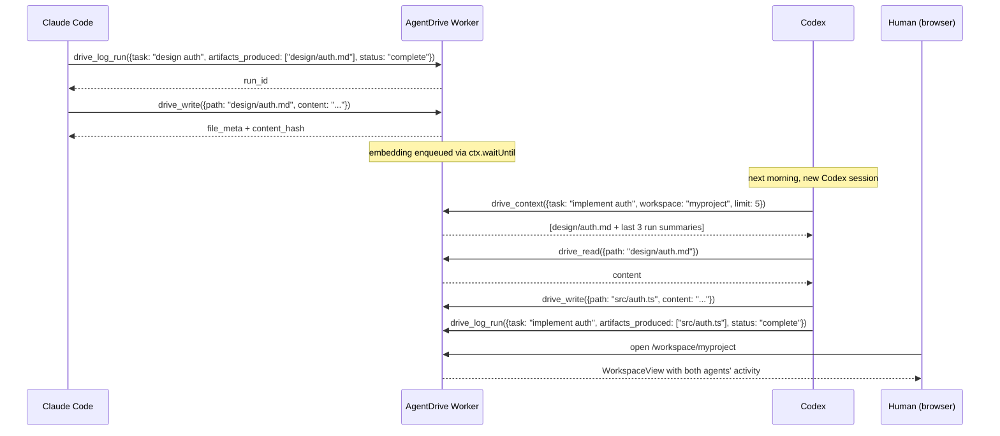
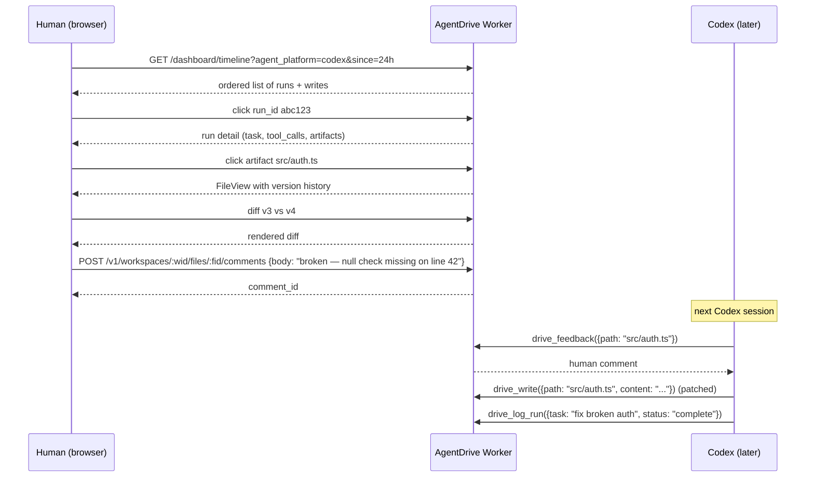
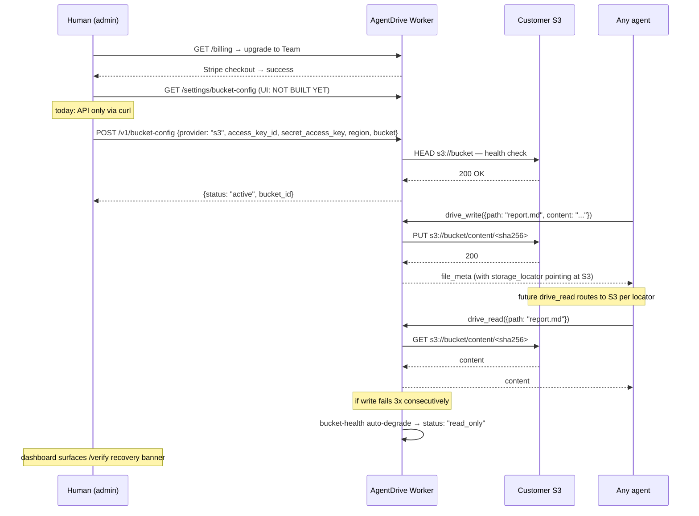
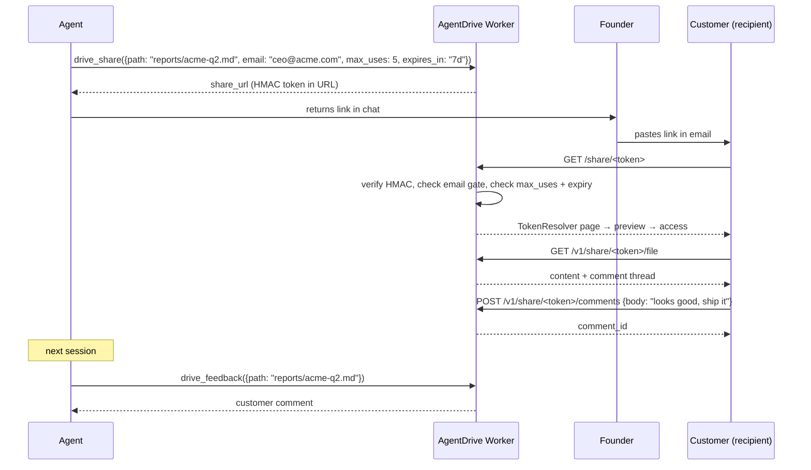
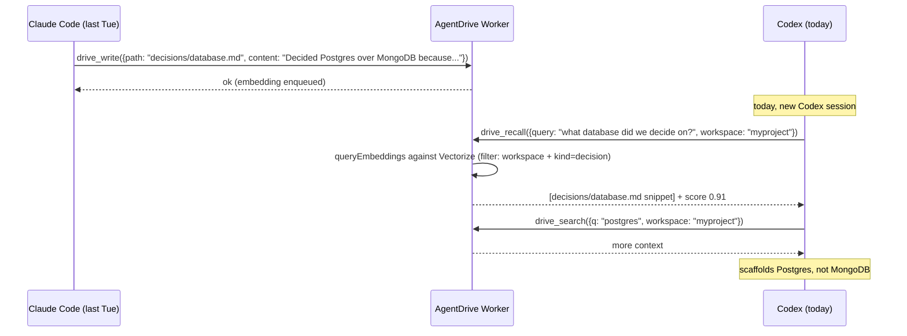
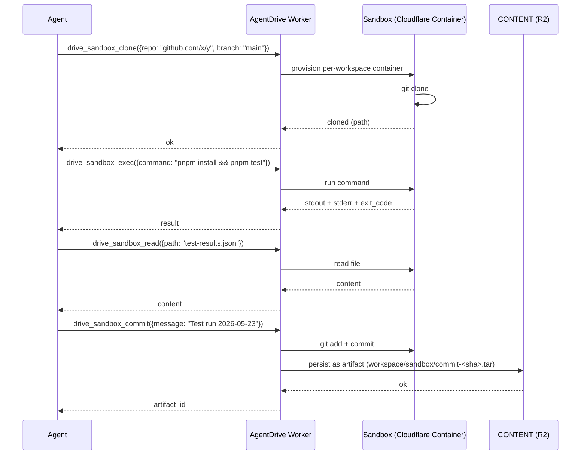

# FLOWS — User flows (tool calls + screens)

**Last updated:** 2026-05-23
**Purpose:** the concrete call sequences that satisfy each JTBD. Each flow names the MCP tools, the REST endpoints, and the frontend screens involved end-to-end.

See [JTBD](./JTBD.md) for the jobs these flows satisfy and [UX](./UX.md) for the screen-by-screen polish priority.

---

## Flow A — Cross-agent handoff (JTBD 1)

**Setup.** Same principal running Claude Code in one terminal and Codex in another. Both have AgentDrive's MCP server wired in via `curl agentdrive.sh/install | sh`.

**Sequence.**

**Endpoints hit.** `POST /v1/runs`, `POST /v1/workspaces/:wid/files` (write), `POST /v1/context`, `GET /v1/workspaces/:wid/files/:fid` (read).

**Frontend screens involved.** None on the agent side. `WorkspaceView` for the human spot-check.

**Latency target.** `drive_context` round trip < 300ms (R2 + Workers edge + Vectorize).

---

## Flow B — Audit a broken deploy (JTBD 2)

**Setup.** Codex shipped a broken file last night. Production broke. Human opens the dashboard at 9am.

**Sequence.**

**Endpoints hit.** `GET /v1/org/timeline`, `GET /v1/runs/:run_id`, `GET /v1/workspaces/:wid/files/:fid/versions`, `POST /v1/workspaces/:wid/files/:fid/comments`, `GET` of same.

**Frontend screens involved.** `DashboardPage` (timeline filter UI), `FileView` (diff), comment sidebar.

**Polish gap.** Version diff renderer is currently functional but not slick — [UX.md](./UX.md) flags as Low priority for $10K MRR.

---

## Flow C — BYO-bucket onboarding (JTBD 4)

**Setup.** Team customer upgraded. Wants artifact content on their own AWS S3 bucket in `eu-west-1` for GDPR.

**Sequence.**

**Endpoints hit.** `POST/GET/PATCH /v1/bucket-config`, `POST /v1/bucket-config/:id/verify`, all normal file write/read paths (which honor the recorded `storage_locator` on `FileMeta`).

**Frontend screens involved.** `BillingPage`, **missing `BucketConfigPage`** (build-priority — see [UX.md](./UX.md)), banner on `DashboardPage` for degraded buckets.

**Latency target.** Configuration round-trip < 3s (one HEAD request to customer's S3 for health check). Steady-state writes match R2 latency within ~20ms (S3 region-pinned, slower than R2 edge).

---

## Flow D — Share an artifact with a human (JTBD 3)

**Setup.** Agent finished a customer report. Founder wants to send it to the customer for review.

**Sequence.**

**Endpoints hit.** `POST /v1/workspaces/:wid/share`, `GET /share/:token`, `GET /v1/token-info`, `GET /v1/share/:token/file`, `POST /v1/share/:token/comments`.

**Frontend screens involved.** `TokenResolver` (public, no auth), comment sidebar.

**Security note.** HMAC uses `TOKEN_SIGNING_SECRET`. Token includes `tid` so revocation is via `KV token:<tid>` lookup. Max-uses tracked in same record.

---

## Flow E — Memory across sessions (JTBD 6)

**Setup.** User told Claude Code last Tuesday "we decided to use Postgres not MongoDB for this project." Today, Codex is asking what database to scaffold.

**Sequence.**

**Endpoints hit.** `POST /v1/search`, semantic search via Vectorize, optional keyword fallback if embeddings fail.

**Embedding pipeline.** Every `drive_write` enqueues via `ctx.waitUntil` to embed via Workers AI `@cf/baai/bge-base-en-v1.5` (768-dim). 16-chunk cap × 1500-char windows. Idempotent (content-addressed).

**Failure modes.** Workers AI rate limit → falls back to OpenAI `text-embedding-3-small` via AI Gateway. Embedding never blocks the write (graceful degradation).

---

## Flow F — Sandbox agent execution (JTBD 5, experimental)

**Setup.** Agent needs to run a test suite against a checked-out repo. Per-workspace isolation required.

**Sequence.**

**Endpoints hit.** `/v1/workspaces/:wid/sandbox/clone`, `/exec`, `/read`, `/commit`.

**Failure mode (graceful).** If `SANDBOX` binding is absent in the worker config (most users — Cloudflare Containers requires a separate plan), all sandbox endpoints return 503 with `{error: "sandbox not configured"}`. The rest of the product works fine.

**Status.** Phase 5, experimental. Not the v1 marketing headline.

---

## Cross-flow patterns

### Authentication pattern (all flows)
Every authenticated request carries:
- `Authorization: Bearer agentdrive_live_<key>` (resolves to principal via `api_key:<sha256(key)>` KV lookup)
- `X-Agent-Platform: claude-code | codex | cursor | langgraph | crewai | autogen | mcp | unknown`
- `X-Agent-Role: <free-form, ≤64 chars>` (optional)

The principal + platform + role together populate provenance on every artifact and run.

### Embedding pattern (Flows A, E)
Embeddings are fire-and-forget via `ctx.waitUntil`. Never block a write. Failures log and degrade gracefully — search still works via keyword fallback.

### Bucket-routing pattern (Flow C, downstream of Flow A and E)
Once a workspace has a `bucket_config` set, all writes route to the configured bucket. The `storage_locator` is recorded on `FileMeta`, so future reads route back to the same place even if the workspace's default bucket changes later.

### Cursor pagination (every list endpoint)
KV list operations are cursor-paginated. Default page size 50, max 1000. Response shape `{data: T[], cursor: string | null}`. Never hardcode `limit: 100` (Wave 1 fix).
